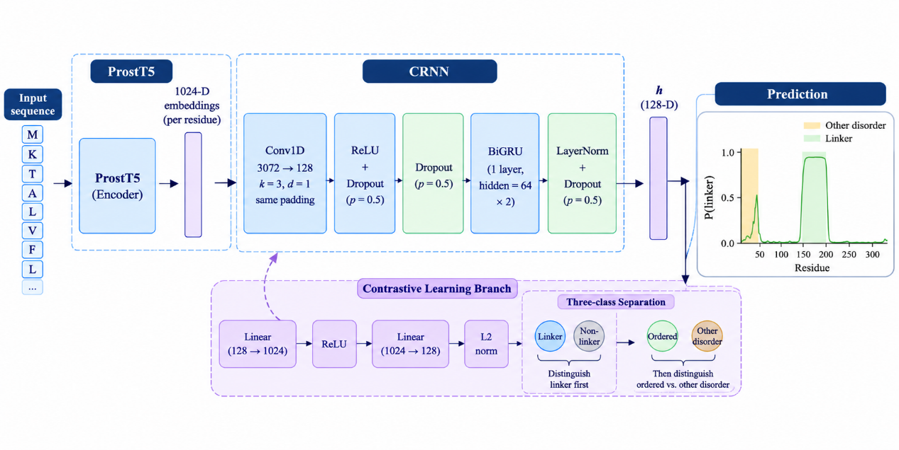
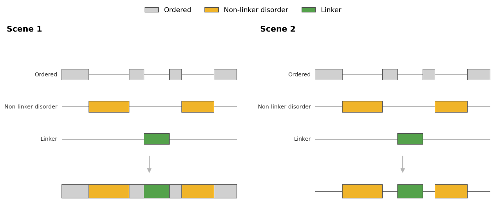

# CLIPer

This is the repository for the paper **CLIPer: Contrastive Learning for Disordered Linker Prediction and Discrimination from Other Disordered Regions**.

Jiahua Hu and Xinning Lu (College of Computer Science, Nankai University) and Kui Wang (NITFID, School of Statistics and Data Science, AAIS, LPMC, and KLMDASR, Nankai University).

## Abstract

Disordered linkers (DLs) are intrinsically disordered regions that connect adjacent functional regions or domains. CLIPer predicts them from a frozen ProstT5 encoder. Each residue is represented by the concatenation of its own 1,024-dimensional embedding and the embeddings of its two neighbors (3,072 dimensions; missing neighbors are zeros). A convolutional layer (kernel size 3, 128 channels) and one bidirectional GRU (hidden size 64 in each direction) then produce a linker probability. Training minimizes binary cross-entropy on the linker label plus a three-class supervised contrastive loss. The classes are ordered residues, disordered non-linker residues, and linkers. The contrastive weight is \(\lambda = 0.2\), and the positive weight on linker residues is about 28. The optimizer is AdamW with learning rate \(2 \times 10^{-4}\). A new checkpoint is kept when Scene 1 AUC improves by at least 0.002. All experiments ran on two NVIDIA RTX A6000 GPUs (48 GB each).



Sequences longer than 1,024 residues are embedded in non-overlapping windows of 1,024 and concatenated in residue order.

## Two evaluation scenes



Scene 1 follows the CAID linker comparison: a linker residue is positive and every other residue is negative. Scene 2 keeps only disordered residues: a linker residue is positive and a disordered non-linker residue is negative. Both scenes use the same residue probabilities. AUC, average precision (APS), and \(F_{1\max}\) are the reported metrics. They do not use a single fixed call threshold. In Scene 1, CLIPer reaches its \(F_{1\max}\) at a probability threshold of 0.874.

Training and validation come from DisProt (December 2023), before CAID3. Linker regions are the DisProt annotations with ontology term IDPO:00502: 280 sequences and 12,399 linker residues, plus 280 sequences that contain disordered non-linker regions. The 560 sequences are split 448 / 112. The test proteins are from CAID3.

| Split | File | Contents in the paper |
| --- | --- | --- |
| Train | `dataset/t2_seqneg/train.fasta` | 448 sequences: 9,812 linker, 33,776 disordered non-linker, and 241,029 ordered residues |
| Validation | `dataset/t2_seqneg/val.fasta` | 2,587 linker, 8,560 disordered non-linker, and 64,548 ordered residues |
| Scene 1 test | `dataset/t2_seqneg/test_caid3.fasta` | 31 CAID3 linker proteins: 1,379 linker, 1,002 disordered non-linker, and 18,117 ordered residues |
| Scene 2 test | `dataset/t2_seqneg/test_scene2_pdb62.fasta` | The Scene 1 linker proteins plus 31 Disorder-PDB proteins without linkers: 1,379 linker residues and 3,983 disordered non-linker residues |

Labels in these files are `0` ordered, `1` disordered non-linker, and `2` linker. CAID3 linker proteins and the proteins listed in `dataset/t2_seqneg/error.txt` are excluded from training and validation.

On Scene 1, CLIPer reaches an AUC of 0.911 and is the only compared method above 0.9. The other methods trail by at least 0.035 AUC. IPA-AF2-Linker is the closest on APS, 0.045 below CLIPer; the remaining methods trail by more than 0.11. \(F_{1\max}\) is about 0.04 or more above the other methods. On Scene 2, CLIPer is about 0.025 AUC above the second-best method and has the highest APS. IPA-AF2-Linker has a higher \(F_{1\max}\) in Scene 2. The ten compared methods are IPA-AF2-Linker, LINKER-Pred2, LINKER-Pred, DisoFLAG-IDR, LINKER-Pred-Lite, DisorderUnetLM, DisoFLAG-DFL, APOD, flDPnn3a, and ESMDisPred-2PDB.

Scene 1 AUC, average precision, and \(F_{1\max}\) on the three CLIPer splits:

| Dataset | AUC | AUPRC | \(F_{1\max}\) |
| --- | --- | --- | --- |
| Training | 0.943 | 0.367 | 0.418 |
| Validation | 0.907 | 0.294 | 0.351 |
| Test | 0.911 | 0.519 | 0.521 |

The residue-level example is DP04392 (IpaH3, *Shigella flexneri*, 571 residues). Residues 269–278 are the linker. Other disordered segments are 1–24, 507–540, and 562–571. On the Scene 2 test set, CLIPer scores on linkers have mean 0.749 and median 0.895. Scores on other disordered residues have mean 0.423 and median 0.378. The ablation in the paper shows that contrastive learning does not raise Scene 1 AUC and does raise Scene 2 AUC.

## Requirements

- Python 3.10 or later
- A CPU is enough to inspect the classification-head checkpoint. Scoring a sequence also needs the ProstT5 weights below and is much faster on a GPU.

```bash
pip install -r requirements.txt
```

## Pretrained weights

Prediction uses two checkpoints. We release the classification head. ProstT5 is the public encoder and is loaded frozen.

### Classification head

The released file is the trained classification head: the convolution, the bidirectional GRU, the linker classifier, and the contrastive projection. It does not contain ProstT5.

```bash
python run_paper_example.py --check-only
```

The command downloads [best.pt](https://github.com/hjhuiuaa/CLIPer/releases/download/Pretrained-Weights/best.pt) from the `Pretrained-Weights` release and saves it to `artifacts/paper/best.pt`. The printed configuration should show one convolution with 128 channels, a bidirectional GRU with hidden size 64 and one layer, `linker_class` 2, and ternary contrastive weight 0.2.

The same file can be fetched directly:

```bash
curl -L -o artifacts/paper/best.pt https://github.com/hjhuiuaa/CLIPer/releases/download/Pretrained-Weights/best.pt
```

### ProstT5

The encoder weights are `Rostlab/ProstT5` on Hugging Face (several gigabytes). Training and prediction call this id through `transformers` and cache the files on first use. To download them before a run:

```bash
huggingface-cli download Rostlab/ProstT5
```

The same download from Python, using the tokenizer settings the code expects (`use_fast=False`):

```bash
python -c "from transformers import AutoTokenizer, T5EncoderModel; AutoTokenizer.from_pretrained('Rostlab/ProstT5', do_lower_case=False, use_fast=False); T5EncoderModel.from_pretrained('Rostlab/ProstT5')"
```

## Predict a sequence

`examples/example.fasta` is DP04381, the shortest protein in the Scene 1 test set (147 residues). The command uses the classification head above and `Rostlab/ProstT5`.

```bash
python run_paper_example.py --device cpu
```

Use `--device cuda` when a GPU is available. The command writes `artifacts/paper_example/predictions.tsv`. Each row is the residue, its linker probability, and a call. The example script calls a residue a linker at probability 0.946, the count-matched operating point on `dataset/t2_seqneg/train.fasta`. The paper's Scene 1 \(F_{1\max}\) is reported at 0.874.

```bash
python run_paper_example.py --fasta your_sequences.fasta --output-dir artifacts/your_run --device cuda
```

The FASTA file has two lines per protein: a header and the sequence.

## Rebuild the data and retrain

```bash
python scripts/prepare_dataset.py
python -m cliper.cli train --config configs/ablation/shared_supcon.yaml
python scripts/eval_two_scenes.py
```

`prepare_dataset.py` rebuilds the training split and both test sets from the DisProt and CAID3 FASTA files in `dataset/`. Training reads `dataset/t2_seqneg/train_val.fasta` and writes under `artifacts/runs/ablation_shared_20261031/supcon`. ProstT5 stays frozen. A GPU is required for a full training run. `eval_two_scenes.py` scores one checkpoint on the Scene 1 and Scene 2 test sets.

## Layout

- `CLIPer.tex` — manuscript
- `cliper/` — model, data, training, and prediction
- `configs/ablation/shared_supcon.yaml` — paper training configuration
- `dataset/t2_seqneg/` — sequences used in the paper
- `examples/example.fasta` — one Scene 1 protein for a prediction check
- `run_paper_example.py` — download the checkpoint and score a FASTA file
- `scripts/prepare_dataset.py` — rebuild the paper splits
- `scripts/eval_two_scenes.py` — score a checkpoint on the two scenes
