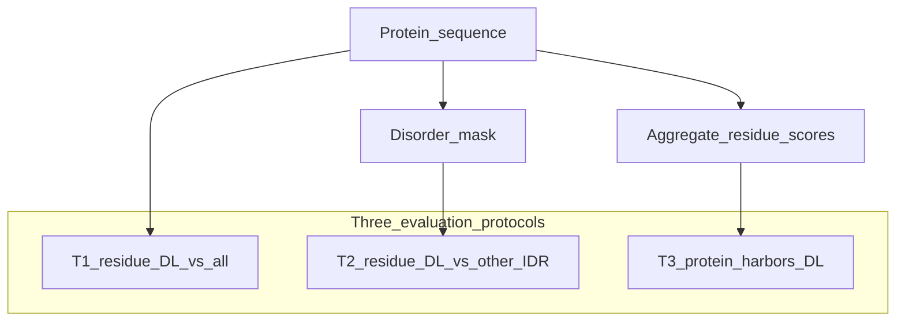
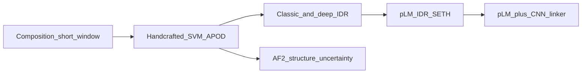

# 无序 Linker（Disordered Linker / DFL）预测调研综述

本文面向组会 / 开题背景：先界定任务与意义，再分析领域瓶颈，梳理基准数据与公开方法排名，最后把本仓库 **CLIPer** 放进方法图谱，并标明与 CAID 盲测的不可比之处。

内部实验结果的详细数字见 [`experiment-analysis.md`](experiment-analysis.md)。本文不重复全部消融表，只保留与领域对照相关的结论。

**主要文献锚点**

| 简称 | 文献 |
| --- | --- |
| CAID3 | Mehdiabadi et al., *Proteins* 2025. [doi:10.1002/prot.70045](https://doi.org/10.1002/prot.70045) — 官方 Linker Top10（时间最新盲测 T1） |
| Basu 2024 | Basu & Kurgan, *Biomolecules* 2024. [doi:10.3390/biom14030287](https://doi.org/10.3390/biom14030287) — CAID2 扩评 T1–T3；**Table 1 = T1、Table 2 = T2（37 方法）** |
| APOD | Peng et al., *Bioinformatics* 2020. [PMC7773485](https://pmc.ncbi.nlm.nih.gov/articles/PMC7773485/) |
| DFLpred | Meng & Kurgan, *Bioinformatics* 2016 |
| SETH | Ilzhöfer et al.；pLM + NMR 连续 disorder 倾向（Basu T1 第二梯队） |
| flDPnn / flDPlr | Hu / Kurgan 等；功能与 linker 叙事的深度 IDR 族 |
| TransDFL | Wang et al., *GPB* 2022 |
| LINKER-Pred | Meng et al., bioRxiv 2025. [doi:10.1101/2025.10.29.685455](https://doi.org/10.1101/2025.10.29.685455) |
| IPA | Malhis, IPA / IPA-AF2（[GitHub](https://github.com/NawarMalhis/IPA)） |

---

## 1. 我们要做的任务是什么？为什么值得做？

### 1.1 对象：什么是 disordered linker

DisProt 将 **linker** 定义为：无结构（无序）区段，在相邻功能区域（常见为折叠结构域）之间提供**间隔与相对运动自由度**。文献中亦称 **disordered flexible linker（DFL）**。

需要刻意区分的三件事：

| 概念 | 是否无序 | 是否本任务 |
| --- | --- | --- |
| 有序 domain–domain linker（PDB 中依赖结构的间隔） | 否 / 部分柔性 | 否（可作互补数据，见 DLD） |
| 任意 IDR（binding、MoRF、低复杂度等） | 是 | 否；DL 只是 IDR 的一个功能亚型 |
| **DisProt / CAID linker（DL）** | 是 | **是** |

换言之：**DL ⊂ IDR**，但「无序」不等于「linker」。能预测 disorder 的模型，不等于能预测 linker。

### 1.2 三类必须胜任的评测协议

Basu & Kurgan（2024）在 CAID2 上明确了三条场景；这也是我们后续 benchmark 的目标框架：

| 协议 | 问题 | 评测对象 | 负样本 |
| --- | --- | --- | --- |
| **T1** | 残基是否在 DL 中 | 全序列残基 | 有序 + 其它 IDR |
| **T2** | 在无序残基里，是否为 DL | 仅 disorder=1 的残基 | **其它无序残基** |
| **T3** | 蛋白是否 harboring DL | 一条蛋白一个分数 | **不含 DL 的蛋白** |

- **T1** 是 CAID 官方 Linker 赛道的默认设定，也是目前绝大多数排行榜数字的来源。
- **T2** 才是「不是又一个 disorder predictor」的试金石。
- **T3** 才是蛋白质组筛选「谁含有 DL」时真正需要的接口。

### 1.3 理论意义

1. **IDR 功能分型（disorder flavors）**  
   无序不是单一现象：binding IDR、linker、低复杂度区等组成不同、位置逻辑不同。DL 预测是把「无序」推进到「无序功能」的必要一步。

2. **多域蛋白的构象物理**  
   Linker 长度与柔性决定结构域相对取向、有效浓度、自抑制与 ball-and-chain 等机制。准确的 DL 边界是理解模块耦合的前提，而不是装饰性注释。

3. **与 binding / MoRF 正交**  
   CAID 同时有 disorder、binding、linker 子挑战。Binding 关心「在 IDR 里哪里结合」；linker 关心「哪里充当间隔」。二者标签集合不同，方法也不可互相替代。

### 1.4 实际意义

- 多域 / 多模块蛋白的自动注释与可视化（域–linker–域示意图）。
- 蛋白质组尺度筛「可能含 DL 的蛋白」（依赖 **T3**，不能只用 T1）。
- 合成生物学与融合蛋白设计中的柔性连接肽选型。
- 社区竞赛：CAID `linker` 赛道；后续可接入 CAID Prediction Portal 一类流水线。

### 1.5 与本仓库 CLIPer 的对接（现状一句话）

CLIPer 目前**主做 T1**：DisProt 清洗后 224 train / 56 val + CAID3 31 蛋白内部 holdout；提交形态为 CAID4 的 LinkCNN / LinkCRNN。  
T2 / T3 **协议脚本与内部数字已落地**（见 [`experiment-analysis.md`](experiment-analysis.md) §8）；相对 Basu 2024 的主要缺口是**尚未在同一 348 蛋白扩评集合上复现 APOD / LINKER-Pred 等公开对照**——不能把内部 CAID3 切片 T2 直接写成公开 SOTA。

---

## 2. 领域现存问题，以及瓶颈背后的本质

下面按「现象 → 本质」写，避免停留在「数据少、很难」的空话。

### 2.1 标注稀缺、定义窄

- DisProt 中约 **10–12%** 的 IDP 被标为 harboring DL（Basu 2024 引 DisProt 9.4：282 / 2649）。
- CAID3 Linker reference：**31 条蛋白**，阳性残基 **1,379（约 6.7%）**（CAID3 正文）。

**本质：** linker 功能注释依赖文献级实验解读，远慢于「这段看起来无序」的判断；可学习的正样本天然稀少。

### 2.2 标签不完备（闭世界假设不成立）

同一条蛋白上，disorder 区常常只有**一部分**被标成 linker。本仓库 [`dataset/error.txt`](../dataset/error.txt) 记录的正是「disorder 与 linker 覆盖不一致」的硬例。

评测时，未标注残基通常当作负样本——其中可能混有「尚未注释的 DL」。

**本质：** 监督学习在用**不完整正例 + 污染负例**； residual 误差里有一部分是标注噪声，不是模型容量问题。

### 2.3 任务被 IDR 预测「带跑」

CAID Linker 赛道会把大量 **disorder 专用预测器**一并评进去。结果是：

- **T1** 上，IDR 模型可以拿到不低的 AUC（因为大量负样本是有序残基，有序 vs 无序本身就好分）。
- **T2** 上，同一批 IDR 模型在 Basu 2024 扩评中**接近随机**；只有专用 DL 方法（当时主要是 APOD，其次 DFLpred）还能工作。

**本质：**  
**DL ⊂ IDR，但 DL 的可分信号是「夹在功能模块之间的间隔角色」，不是「无序本身」。**  
优化 IDR 目标函数，学不到 T2 所需的判别。

### 2.4 类别极不平衡 + 生物学上是短连续段

阳性比例约 5–7%；生物学上 DL 是**连续 run**（DisProt linker 区段中位长度约 20–24 残基量级）。

**本质：**

- **AUROC** 容易虚高（大量真负例抬高排序）。
- **AUPRC / APS、F1、MCC、区段级 F1** 才反映「找得到短片段」。
- 只优化残基交叉熵，不约束连续性时，预测会碎；反过来强 RNN 又容易在小验证集上过拟合连续段模式（CLIPer Stage 7 已出现）。

### 2.5 分布偏移：评测集几乎全是「已知含 DL 的蛋白」

CAID 官方 Linker reference **只收录至少有一个 linker 区的蛋白**。在这种集合上：

- T1 数字有意义；
- **T3 无法成立**（没有负蛋白）；
- 训练若再丢掉全 0 蛋白（CLIPer 清洗 2896→298），模型更从未见过「无 DL 蛋白」的分布。

**本质：** 官方 T1 基准在回答「已知有 DL 时，残基在哪」；**没有**回答「蛋白质组里谁有 DL」。

### 2.6 计算与部署约束

CAID 要求：CPU、无网、内存 / 线程上限、单序列时限（本仓库提交说明为 ≤6 h）。  
结构依赖方法（如 IPA-AF2）在精度上可领先，但覆盖率、打包与预计算成本更高。

**本质：** SOTA 榜上的第一名，不一定是可大规模复现、可 Docker 提交的第一名。工程约束会筛选方法族。

---

## 3. 基准数据集：有没有、怎么用、能不能自己做？

### 3.1 已有、可用的高质量来源

| 资源 | 用途 | 规模 / 特点 | 缺陷 |
| --- | --- | --- | --- |
| **DisProt** | 训练与内部划分主源 | 人工实验证据；功能标签含 linker | 不完备；版本需钉死时间戳 |
| **CAID2 Linker（官方）** | 早期盲测 T1 | ~40 条「已知含 DL」蛋白 | 太窄；无 T2/T3 |
| **CAID2 全库扩评（Basu 2024）** | **同时覆盖 T1–T3** | 348 蛋白 / 287,020 残基；40 条含 DL；2,023 个 DL 残基 | 非官方 CAID 表；需自己按协议重算 |
| **CAID3 Linker** | 当前最干净的盲测 **T1** | 31 蛋白；阳性 6.7%；相对 2023-12 DisProt 的时间差集 | **无官方 T2/T3**；n 小、方差大 |
| **TE82 等早期划分** | 复现 DFLpred / APOD / TransDFL | 小 | 易过时、与 CAID 不可比 |
| **DLD（LINKER-Pred 2025）** | 结构域间独立 linker（IDL） | 2646 PDB 链，1405 条含 IDL | 与 DisProt **功能 DL 定义不完全相同**；宜分域报告 |

CLIPer 当前数据落点：

- 训练：[`dataset/disprot_202312_linker_label.fasta`](../dataset/disprot_202312_linker_label.fasta)（清洗后仅保留含 ≥1 linker 的蛋白）
- 内部测试：[`dataset/linker.fasta`](../dataset/linker.fasta)（CAID3 linker，31 条）
- 并行 disorder 标签：[`dataset/disprot_202312_label.fasta`](../dataset/disprot_202312_label.fasta)、[`dataset/disorder_pdb.fasta`](../dataset/disorder_pdb.fasta)（已用于内部 T2；见 experiment-analysis §8）

### 3.2 现有基准的提升空间（不必从零建库）

在同一套 CAID / DisProt 序列上，用**协议层**就能显著提高评测信息量：

1. **T2：** `disorder_mask ∩ linker_label`，只在无序残基上算 AUPRC / AUROC；另报 `error.txt` 子集。
2. **T3：** 把清洗丢掉的全 0 蛋白、以及 CAID disorder 中无 linker 的蛋白，按蛋白级划分纳入负样本；残基分数用滑动窗口均值 / top-k 聚合。
3. **区段级指标：** segment-wise F1、边界偏移、预测长度分布 vs 标注长度。
4. **报告覆盖率（Cov）** 与失败序列列表（与 CAID 对齐）。
5. **多种子 / 置信区间：** CAID3 仅 31 条，单点 AUC 差 0.01–0.02 可能无统计意义。

### 3.3 若要「自己搞一个」基准，建议什么方式？

优先级从高到低：

| 优先级 | 做法 | 说明 |
| --- | --- | --- |
| 高 | **协议层基准** | 固定 DisProt / CAID 快照 + 公开脚本（[caid-reference](https://github.com/BioComputingUP/caid-reference)），实现 T1/T2/T3 与区段指标 |
| 高 | **时间切割复现 CAID** | 用「旧 DisProt → 新 DisProt」差集，避免泄漏 |
| 中 | **合并 DLD + DisProt** | 结构 IDL 与功能 DL **分开报**，不要简单混标后吹 SOTA |
| 中 | **硬例集** | 部分覆盖（`error.txt` 类）、超长链、多 linker 蛋白 |
| 低 | 全新湿实验标注 | 成本高；适合长期与湿实验组合作，不适合作为第一里程碑 |

结论：**高质量基准已经有（DisProt + CAID）**；缺的是 **T2/T3 与区段协议**，不是缺一个新名字的数据库。自建的正确姿势是「在官方数据上把评测做完整」，而不是另起炉灶。

---

## 4. 方法层面：有哪些方法？公开基准上效果如何？谁好谁差？

### 4.0 两套榜怎么读（先读这段）

本领域至少有两张**不可混读**的成绩单：

| 榜 | 集合 | 覆盖任务 | 时间 | 读法 |
| --- | --- | --- | --- | --- |
| **Basu 2024 扩评** | CAID2 全库 **348** 蛋白（含 40 条有 DL） | **T1 + T2 + T3** | 评的是 CAID2 参赛方法 | 协议完整；回答「是不是真会 DL」 |
| **CAID3 官方 Linker** | **31** 条已知含 DL 的蛋白 | **仅 T1** | 更新一轮盲测 | 时间最新；顶线被 pLM / AF2 专用方法抬高 |

因此：「Basu 表上 APOD 第一」与「CAID3 表上 IPA-AF2 / LINKER-Pred 第一」**可以同时成立**——评测轮次与协议不同。CAID3 Top 方法（LINKER-Pred、IPA-AF2、DisoFLAG、DisorderUnetLM 等）**不在** Basu 的 37 方法名单里。

Basu 表中指标旁的 `+` / `=`：相对当时最强方法 **APOD** 的统计显著性（`+` = 显著更差，`=` = 无显著差异）。下文全表保留该标记。

### 4.1 方法世代（概念图）

| 世代 | 代表（含 Basu 全表与近期 SOTA） | 核心思路 |
| --- | --- | --- |
| 组成 / 短窗 | DFLpred、IUPred3、ESpritz-*、FoldUnfold、pyHCA | 局部组成或势能；快，但看不到「两域之间」 |
| 手工特征 + SVM | **APOD** | 保守性、SS、RSA、disorder 预测、蛋白级 disorder 含量 |
| 经典 IDR | DISOPRED3、VSL2、RONN、MobiDB-lite、IsUnstruct | 历史 disorder 基线；T1 约 0.60 |
| 深度 IDR | flDPnn(2)、SPOT-Disorder、Dispredict3、Metapredict、DeepIDP、IDP-Fusion、rawMSA | CNN/RNN/集成；无序强，linker 非目标 |
| pLM-IDR | **SETH-0/1**、PredIDR | 语言模型 +（SETH）NMR 连续 disorder；T1 可蹭到 APOD 附近 |
| IDR→DFL 迁移 | TransDFL | 迁移学习；动机对，公开榜未进新顶列 |
| **近期专用 / 近专用 SOTA** | **LINKER-Pred** 族、**IPA-AF2-Linker**、DisoFLAG、DisorderUnetLM、**CLIPer** | pLM+浅 CNN，或 AF2 不确定性，或功能多头 |
| 结构代理基线 | AlphaFold-pLDDT / RSA（CAID 系列） | 低置信度 / 高暴露 ≈ 柔性；非专用 DL |

### 4.2 Basu 2024 Table 1 全文（CAID2 扩评 · T1）

**设定：** CAID2 全库 **348** 蛋白 · **T1**（DL 残基 vs 非 DL）· 覆盖率 ≥90% 的 37 个方法 · 按 AUC 降序。  
**来源：** Basu & Kurgan, *Biomolecules* 2024, Table 1。数值为十次测试平均；`+`/`=` 相对 APOD。

| Predictors | AUC | lowAUCratio | AUPRC | F1max | MCCmax |
| --- | ---: | ---: | ---: | ---: | ---: |
| **APOD** | **0.723** | **3.82** | **0.292** | **0.381** | **0.281** |
| SETH-1 | 0.712 = | 2.70 + | 0.241 + | 0.349 + | 0.241 + |
| SETH-0 | 0.708 = | 2.96 + | 0.257 + | 0.340 + | 0.230 + |
| PredIDR-short | 0.694 + | 3.15 + | 0.246 + | 0.341 + | 0.244 + |
| PredIDR-long | 0.683 + | 2.90 + | 0.233 + | 0.337 + | 0.246 + |
| Dispredict3 | 0.682 = | 1.61 + | 0.205 + | 0.346 + | 0.234 + |
| AUCpreD | 0.675 + | 1.94 + | 0.210 + | 0.328 + | 0.207 + |
| flDPnn | 0.661 + | 1.81 + | 0.204 + | 0.340 + | 0.225 + |
| flDPnn2 | 0.653 + | 1.91 + | 0.200 + | 0.330 + | 0.214 + |
| IDP-Fusion | 0.652 + | 1.51 + | 0.193 + | 0.328 + | 0.204 + |
| s2D | 0.648 + | 1.72 + | 0.189 + | 0.302 + | 0.171 + |
| flDPlr2 | 0.646 + | 2.48 + | 0.215 + | 0.338 + | 0.221 + |
| DeepIDP-2L | 0.642 + | 1.56 + | 0.197 + | 0.340 + | 0.222 + |
| PreDisorder | 0.641 + | 3.00 + | 0.262 = | 0.350 + | 0.219 + |
| RONN | 0.640 + | 1.51 + | 0.185 + | 0.301 + | 0.171 + |
| flDPtr | 0.635 + | 1.58 + | 0.183 + | 0.301 + | 0.171 + |
| IsUnstruct | 0.631 + | 1.31 + | 0.178 + | 0.303 + | 0.178 + |
| Metapredict | 0.629 + | 0.52 + | 0.163 + | 0.296 + | 0.171 + |
| DisoPred | 0.621 + | 1.84 + | 0.192 + | 0.307 + | 0.179 + |
| SPOT-Disorder-Single | 0.620 + | 1.46 + | 0.176 + | 0.290 + | 0.151 + |
| SPOT-Disorder | 0.617 + | 0.91 + | 0.169 + | 0.301 + | 0.173 + |
| DisEMBL-disHL | 0.616 + | 1.75 + | 0.179 + | 0.278 + | 0.137 + |
| DisoMine | 0.615 + | 0.63 + | 0.161 + | 0.290 + | 0.159 + |
| ESpritz-N | 0.615 + | 1.63 + | 0.179 + | 0.280 + | 0.141 + |
| MobiDB-lite | 0.613 + | 1.74 + | 0.176 + | 0.282 + | 0.142 + |
| DisEMBL-dis465 | 0.610 + | 1.76 + | 0.179 + | 0.279 + | 0.137 + |
| DISOPRED3 | 0.609 + | 0.79 + | 0.163 + | 0.299 + | 0.164 + |
| rawMSA | 0.606 + | 1.70 + | 0.187 + | 0.323 + | 0.197 + |
| VSL2 | 0.605 + | 0.67 + | 0.155 + | 0.290 + | 0.157 + |
| IUPred3 | 0.602 + | 1.21 + | 0.165 + | 0.281 + | 0.143 + |
| ESpritz-X | 0.602 + | 1.25 + | 0.168 + | 0.276 + | 0.132 + |
| AIUPred | 0.595 + | 0.84 + | 0.160 + | 0.283 + | 0.145 + |
| FoldUnfold | 0.581 + | 1.39 + | 0.154 + | 0.263 + | 0.109 + |
| Dispredict2 | 0.573 + | 1.22 + | 0.160 + | 0.274 + | 0.121 + |
| pyHCA | 0.569 + | 1.54 + | 0.165 + | 0.266 + | 0.136 + |
| DFLpred | 0.526 + | 1.51 + | 0.153 + | 0.235 + | 0.070 + |
| ESpritz-D | 0.512 + | 0.99 + | 0.138 + | 0.253 + | 0.109 + |

**分层解读（不必逐方法立传）**

| 层 | 方法 | 解读 |
| --- | --- | --- |
| 专用 DL 顶 | **APOD** | 全指标第一；T2/T3 仍几乎只靠它 |
| IDR 蹭 T1 上沿 | SETH-0/1、PredIDR-short/long、Dispredict3、PreDisorder | T1 AUC ≥0.68，AUPRC 仍显著低于 APOD；**T2 上会崩** |
| 中游深度 IDR | flDPnn(2)、flDPlr2、IDP-Fusion、SPOT-*、DeepIDP-2L、rawMSA、Metapredict、AUCpreD、s2D 等 | 无序预测可用；**不当 linker 专用基线** |
| 经典基线 | IUPred3、DISOPRED3、VSL2、RONN、MobiDB-lite、ESpritz-N/X、DisEMBL、IsUnstruct | 历史对照；T1 约 0.60，AUPRC ~0.16–0.18 |
| 垫底 / 反例 | **DFLpred**、ESpritz-D、pyHCA、FoldUnfold、Dispredict2、AIUPred | 专用过简（DFLpred）或目标/特征错配 |

**SETH 为何能在 T1 逼近 APOD、却不能替代专用 DL：**  
SETH 用蛋白语言模型，并在 NMR / 化学位移得到的**连续 disorder 倾向**上训练，比多数「二值 disorder」监督更贴近柔性梯度，因此在「全序列里挑 DL」（负样本大量是有序残基）时排序不错。但它优化的仍是 **disorder 强度**，不是「夹在功能模块之间的间隔角色」。Basu 的 T2（只在无序残基内分 DL）表明：除 APOD（及较弱的 DFLpred）外，含 SETH 在内的 IDR 族整体接近随机——**T1 高分 ≠ 会辨认 linker**。

对比：同一批方法若只评「已知含 DL 的 ~40 条」这种窄 T1，CAID2 官方叙事曾出现「disorder 预测器看起来更强」——扩到 348 蛋白后，这种错觉消失。

### 4.3 Basu 2024 Table 2 全文（CAID2 扩评 · T2）+ T3 摘要

**设定：** CAID2 全库 **348** 蛋白 · **T2**（仅在 native disordered 残基上：DL vs 其它无序残基）· 37 方法 · 按 AUC 降序。  
**来源：** Basu & Kurgan, *Biomolecules* 2024, Table 2（含 Cont.；[PMC10968229](https://pmc.ncbi.nlm.nih.gov/articles/PMC10968229/)）。十次测试平均；`+` = 相对 APOD 显著更差（p&lt;0.05）。

这是目前**唯一公开发表、覆盖 37 方法的 T2 排行榜**。公开 **T2 SOTA 仍是 APOD**。

| Predictors | AUC | lowAUCratio | AUPRC | F1max | MCCmax |
| --- | ---: | ---: | ---: | ---: | ---: |
| **APOD** | **0.724** | **3.00** | **0.269** | **0.367** | **0.264** |
| DFLpred | 0.614 + | 1.63 + | 0.181 + | 0.279 + | 0.136 + |
| s2D | 0.541 + | 1.03 + | 0.142 + | 0.249 + | 0.076 + |
| PredIDR-short | 0.530 + | 2.17 + | 0.173 + | 0.290 + | 0.159 + |
| PreDisorder | 0.517 + | 1.98 + | 0.172 + | 0.270 + | 0.135 + |
| SETH-0 | 0.512 + | 1.88 + | 0.167 + | 0.251 + | 0.108 + |
| DisEMBL-disHL | 0.506 + | 0.76 + | 0.128 + | 0.237 + | 0.043 + |
| PredIDR-long | 0.505 + | 2.11 + | 0.168 + | 0.284 + | 0.160 + |
| SETH-1 | 0.503 + | 1.07 + | 0.136 + | 0.248 + | 0.077 + |
| DisEMBL-dis465 | 0.495 + | 0.68 + | 0.126 + | 0.239 + | 0.046 + |
| RONN | 0.482 + | 0.61 + | 0.124 + | 0.241 + | 0.059 + |
| AUCpreD | 0.477 + | 1.01 + | 0.128 + | 0.236 + | 0.039 + |
| DISOPRED3 | 0.474 + | 0.55 + | 0.120 + | 0.239 + | 0.052 + |
| Dispredict2 | 0.465 + | 0.47 + | 0.114 + | 0.232 + | 0.055 + |
| IsUnstruct | 0.449 + | 0.46 + | 0.113 + | 0.236 + | 0.043 + |
| ESpritz-N | 0.447 + | 0.81 + | 0.119 + | 0.233 + | 0.048 + |
| FoldUnfold | 0.437 + | 0.83 + | 0.119 + | 0.186 + | 0.003 + |
| DeepIDP-2L | 0.427 + | 0.18 + | 0.109 + | 0.237 + | 0.042 + |
| Dispredict3 | 0.427 + | 0.08 + | 0.106 + | 0.227 + | 0.042 + |
| flDPlr2 | 0.421 + | 0.10 + | 0.108 + | 0.236 + | 0.051 + |
| ESpritz-X | 0.420 + | 0.80 + | 0.117 + | 0.234 + | 0.042 + |
| MobiDB-lite | 0.419 + | 0.30 + | 0.113 + | 0.206 + | 0.009 + |
| Metapredict | 0.415 + | 0.46 + | 0.112 + | 0.239 + | 0.063 + |
| SPOT-Disorder-Single | 0.414 + | 0.42 + | 0.109 + | 0.233 + | 0.040 + |
| flDPnn | 0.412 + | 0.01 + | 0.104 + | 0.235 + | 0.045 + |
| VSL2 | 0.409 + | 0.19 + | 0.103 + | 0.234 + | 0.036 + |
| rawMSA | 0.401 + | 0.00 + | 0.103 + | 0.235 + | 0.035 + |
| flDPnn2 | 0.400 + | 0.07 + | 0.102 + | 0.234 + | 0.043 + |
| IUPred3 | 0.397 + | 0.62 + | 0.106 + | 0.233 + | 0.042 + |
| IDP-Fusion | 0.390 + | 0.11 + | 0.102 + | 0.236 + | 0.032 + |
| SPOT-Disorder | 0.383 + | 0.28 + | 0.101 + | 0.230 + | 0.030 + |
| AIUPred | 0.380 + | 0.50 + | 0.105 + | 0.233 + | 0.045 + |
| pyHCA | 0.368 + | 0.60 + | 0.105 + | 0.227 + | 0.028 + |
| flDPtr | 0.367 + | 0.10 + | 0.096 + | 0.231 + | 0.033 + |
| DisoPred | 0.360 + | 0.37 + | 0.101 + | 0.238 + | 0.031 + |
| DisoMine | 0.340 + | 0.04 + | 0.092 + | 0.233 + | 0.046 + |
| ESpritz-D | 0.282 + | 0.16 + | 0.087 + | 0.229 + | 0.033 + |

**分层解读**

| 层 | 方法 | 解读 |
| --- | --- | --- |
| 公开 T2 SOTA | **APOD** | AUC/AUPRC 几乎维持 T1 水平；唯一能「在无序里认 linker」的方法 |
| 专用但弱 | **DFLpred** | 显著逊于 APOD，但仍优于随机（AUC 0.61） |
| IDR 族崩盘 | SETH、PredIDR、flDPnn、IUPred3、SPOT-* 等 | AUC ≤0.54；T1 可蹭分，**T2 近随机** |

**同一扩评上的 T3（精简；Table 3 全文不在此展开）**

| 方法 | AUC | AUPRC | MCC |
| --- | ---: | ---: | ---: |
| **APOD** | **0.664** | **0.226** | 0.219 |
| DFLpred | 0.633 | 0.191 | 0.171 |
| 多数 IDR 方法 | ≤0.60 | ≤0.18 | 更低 |

Basu 原文动机句：**即使当时最强的 APOD，三类任务也只是中等（AUC 约 0.66–0.72）——需要新的、更准的 DL 预测器。** 这直接指向下一节的 CAID3 / 2025 方法——但那些新方法**尚未公布 T2**。

### 4.3.1 2025 之后有没有新的 T2 榜？

**没有。** 近期顶线抬高的是 **T1**；勿把 CAID3 / LINKER-Pred 的 AUC·APS 写成 T2 SOTA。

| 来源 | 协议 | 集合 | T2 数字？ | 当前能写的结论 |
| --- | --- | --- | --- | --- |
| Basu 2024 Table 2 | **T2** | CAID2 348 蛋白 | 有，37 方法全表 | **公开 T2 SOTA = APOD** |
| CAID3 Table 5 | 官方 Linker = **T1** | 31 蛋白（均含 DL） | **无** | IPA-AF2 / LINKER-Pred 是 **T1** 顶线 |
| LINKER-Pred preprint 2025 Table 1 | CAID2/3 Linker = **T1** | 40 / 31 | **无** | 作者自报 T1；有「低非特异预测其它 IDR」的定性图，无 IDR 内指标 |
| TransDFL 2022 situation-I | 接近 T2（去掉有序与未标注无序） | TE82 / TE64 | 有，但集小、过时 | TE82 AUROC：TransDFL 0.835 vs APOD 0.816；**不替代 Basu 扩评** |

CLIPer 内部 T2（CAID3 31 条上 AUPRC ~0.85）**不写入本 SOTA 表**：该切片阳性率约 58%，与 Basu 稀疏 T2 不可比。内部数字见 [`experiment-analysis.md`](experiment-analysis.md) §8。

### 4.4 CAID3 + 2025 近期 SOTA（时间最新的盲测 T1）

来源：CAID3 *Proteins* 2025，Table 5（按 **AUC**）。相对 CAID2，Linker 顶线 **APS 提升 >31%**，主因是**新专用方法 + pLM / 结构特征**，不是把上表旧 IDR 模型再刷一遍。

| 排名（按 AUC） | 方法 | 新方法 | pLM | AUC | APS | Cov |
| ---: | --- | --- | --- | ---: | ---: | ---: |
| 1 | **IPA-AF2-Linker** | ✓ | — | **0.897** | **0.474** | 0.903 |
| 2 | LINKER-Pred2 | ✓ | ✓ | 0.875 | 0.365 | 1.000 |
| 3 | LINKER-Pred | ✓ | ✓ | 0.870 | 0.377 | 1.000 |
| 4 | DisoFLAG-IDR | ✓ | ✓ | 0.866 | 0.312 | 0.967 |
| 5 | LINKER-Pred-Lite | ✓ | ✓ | 0.854 | 0.393 | 1.000 |
| 6 | DisorderUnetLM | ✓ | ✓ | 0.851 | 0.257 | 1.000 |
| 7 | DisoFLAG-DFL | ✓ | ✓ | 0.846 | 0.392 | 0.967 |
| 8 | APOD |  |  | 0.843 | 0.321 | 1.000 |
| 9 | FlDPnn3a | ✓ | ✓ | 0.841 | 0.228 | 1.000 |
| 10 | ESMDisPred-2PDB | ✓ | ✓ | 0.836 | 0.345 | 0.806 |

说明：IPA-AF2 用 AlphaFold2 衍生特征而非典型序列 pLM 嵌入。「pLM」列按 CAID3 文中方法族归纳。

**怎么读这张新榜**

- **精度天花板：** IPA-AF2-Linker（结构不确定性）；Cov 0.903，约 10% 序列无输出。
- **序列 / 可部署天花板：** LINKER-Pred 族（Cov=1）。
- **旧专用方法：** APOD 仍进 Top10，但 APS（0.321）已被 LINKER-Pred / IPA 拉开。
- **IDR 仍在蹭 T1：** DisoFLAG-IDR、DisorderUnetLM、FlDPnn3a、ESMDisPred——再次提醒不能只用 CAID3 T1 证明「学会了 linker」。
- **与 Basu 全表的关系：** 上表方法大多**晚于** Basu 评测；应用「Basu 看协议完整性，CAID3 看时间顶线」。

LINKER-Pred preprint（2025）精炼后作者自报（**非盲测**）：LINKER-Pred2 AUC 0.907 / APS 0.456；LINKER-Pred 0.904 / 0.447。可作上界参考，答辩时须标明。

### 4.5 方法卡片：强在哪、差在哪

精讲控制在代表性方法；Basu 全表其余方法见 4.2 分层，不逐条展开。

#### DFLpred（2016）— 专用但过简

- **做法：** 小特征集 + 快速线性模型；强调全蛋白质组吞吐。
- **Basu T1：** AUC 0.526 / AUPRC 0.153（垫底档）；T2 仍优于多数 IDR（0.614）。
- **差因：** 不用进化 / 结构；局部窗看不到域间角色；容量过低。

#### APOD（2020）— 三类任务上曾唯一全面可用

- **做法：** 保守性、预测 SS / RSA、DISOPRED3、**蛋白级 disorder 含量** + SVM。
- **Basu：** T1/T2/T3 全面第一（AUC 0.72 / 0.72 / 0.66）。**CAID3 T1：** AUC 0.843 / APS 0.321。
- **局限：** 手工特征 + SVM 上限；相对 2025 pLM/AF2，APS 已落后。

#### SETH（Basu T1 第二梯队）

- **做法：** 蛋白语言模型 + 偏向 NMR 连续 disorder 监督。
- **Basu T1：** AUC 0.708–0.712（与 APOD AUC 无显著差），但 AUPRC / MCC 显著更低。
- **定位：** 证明「更好的 disorder 表征」能抬 T1；**不能**替代专用 DL（见 T2）。

#### flDPnn / flDPlr 族

- **做法：** 深度网络；叙事上覆盖 disorder 功能与 linker。
- **Basu T1：** flDPnn 0.661、flDPlr2 0.646（中游）；**T2 失败**（与其它 IDR 一样）。
- **CAID3：** FlDPnn3a 进 Top10（AUC 0.841）——仍是新一轮 T1 蹭分，未改变「目标是不是 DL」的问题。

#### IUPred3 / DISOPRED3 — 经典基线

- **Basu T1：** AUC 0.602 / 0.609。AUPRC ~0.16。
- **为何仍常被引用：** 实现简单、无重依赖、作 disorder 对照；**不是** DL SOTA，也不应作为唯一对照。

#### TransDFL

- 从 IDR 迁移到 DFL；动机（DL ⊂ IDR）正确。
- 迁移解决冷启动，不自动带来 T2 判别；公开 CAID 未进新顶列。

#### DisoFLAG（DFL / IDR 头）

- **CAID3：** DFL 0.846；IDR 0.866（T1 上 IDR 头更高）。
- T1 蹭分符合机制；T2 预期弱。本仓库**未**独立复现。

#### LINKER-Pred / Lite / 2（CAID3 + 2025）— 序列侧近期 SOTA

- ProtTrans（± MSA-Transformer）+ 浅 CNN（M2M）；训练含 **DLD 结构 IDL + DisProt DFL**。
- **CAID3：** AUC 0.85–0.88，Cov=1。
- 与 **CLIPer** 同族：预计算 pLM + 局部卷积；数据侧负样本 / 域上下文被作者强调。

#### IPA-AF2-Linker — CAID3 精度第一

- AF2 pLDDT / 可及性 + IPA 概率校准。
- **CAID3：** AUC 0.897 / APS 0.474；Cov 0.903。
- 强在物理代理「柔性间隔」；弱在覆盖、打包与无结构场景。

#### 非专用但仍进 CAID3 Top10 的 IDR / ESM 方法

DisorderUnetLM、ESMDisPred-2PDB 等：T1 可进榜；在 Basu 式 T2 逻辑下预期失败。**差因是目标错配，不是网络不够深。**

### 4.6 「表现不好」的共同模式

1. **根本不是为 DL 训练的**（Basu 37 方法里绝大多数是 IDR 预测器）。  
2. 把 DL 当成 IDR 来训 / 来评。  
3. 只有氨基酸组成或极短窗口，没有进化、结构或蛋白级上下文。  
4. 只在「已知含 DL」的小集合上刷 AUC，忽略 T2/T3。  
5. 覆盖率低，却与 Cov=1 的方法直接比分。  
6. 训练分布全是正蛋白，T3 必然虚空。

### 4.7 关于「复现效果」的声明

本节数字均来自**公开发表的 CAID / Basu 扩评 / preprint**，**不是**本仓库对 37 方法或 CAID3 Top 的独立复现。  
若需要「我们复现了 X」，必须另开实验：固定相同 FASTA、相同指标实现（含 CAID 的 APS 阈值扫描）、报告 Cov。完成前只能引用文献值并写明「未独立复现」。

---

## 5. CLIPer 在图谱中的位置（结合已有成果）

### 5.1 方法定位

| 项目 | CLIPer |
| --- | --- |
| 骨干 | 冻结 **Rostlab/ProstT5**，残基嵌入 `[L, 1024]` |
| 局部上下文 | `concat_window`（半径 1 → 每点 3072 维） |
| 主头（提交） | **CNN**：三层膨胀卷积（LinkCNN） |
| 第二头 | **CRNN**：两层膨胀卷积 + 双向 GRU（LinkCRNN） |
| 训练目标 | 加权 BCE；按验证 **AUPRC** 选 checkpoint |
| 赛道形态 | CAID4 Docker：预计算 embedding → CPU predict |

与 **LINKER-Pred** 同属「pLM + 浅 CNN」世代；与 **IPA-AF2** 不同，不依赖 AlphaFold 结构。名称中的对比学习（Stage 2 SupCon）在消融中**相对线性基线无 CAID3 增益**，后续阶段已关闭。

### 5.2 内部 holdout 数字（标签已知后的测试，≠ CAID3 盲测）

数据：与官方 CAID3 Linker 同规模的 31 蛋白 / 20,498 计分残基（本仓库 `dataset/linker.fasta`）。  
训练：DisProt 2023-12 清洗划分。指标来自 `artifacts/runs/.../metrics/caid3_metrics.json`。

| 模型 | CAID3 AUPRC | AUROC | F1 | MCC |
| --- | ---: | ---: | ---: | ---: |
| **LinkCNN**（S4 CNN T1 `exp0001`） | **0.571** | 0.925 | **0.572** | 0.542 |
| LinkCNN regularized | 0.569 | **0.926** | 0.568 | 0.544 |
| LinkCRNN（S7 a1 `exp0005`） | 0.536 | 0.914 | 0.539 | 0.504 |
| Stage 1 线性基线 | 0.513 | ~0.917 | 0.539 | 0.509 |

### 5.3 不可比声明（答辩 / 论文必须写清）

1. CAID3 官方数字是**方法提交时标签尚未公开**的盲测；CLIPer 上述数字是**标签已知后**在同一规模集合上的内部测试。  
2. 因此 **不能**把 LinkCNN 的 AUROC 0.925 写成「超过 IPA-AF2 的 0.897」。  
3. 可公平对标的出口是：**CAID4 官方评测**，以及在 **Basu 式 T1–T3 协议**上与公开方法同表复现。  
4. 文献对照时同时引用两套榜：**Basu 全表（协议完整，含负蛋白）** 与 **CAID3 Top（时间最新）**——勿只用其中一张。  
5. 即使内部 AUROC 很高，AUPRC 0.57 与 CAID3 顶线 APS 0.47 仍说明：**排序容易，精确找回短阳性段仍然难**——与领域共性一致。

### 5.4 消融如何对应领域问题

| CLIPer 观察 | 对应的领域解读 |
| --- | --- |
| SupCon ≈ 线性基线 | 冻结 pLM 后残基空间已可分；对比学习不是瓶颈 |
| MLP12 / 小 Transformer 头差或坍缩 | 重复主干全局建模，缺少「短连续段」归纳偏置 |
| CNN + concat_window 最优 | 与 LINKER-Pred「浅卷积」结论一致；局部偏置匹配 DL 形态 |
| Stage 5 PROSITE motif 全面退步 | 改 tokenizer 破坏与预计算 embedding 一致性；motif 覆盖低 |
| CRNN 验证 AUPRC 可到 0.52，CAID 掉到 0.46 | 小 n 下过拟合连续段；不能用最高 val 直接提交 |
| 训练丢掉全 0 蛋白 | 有利于 T1，但 **直接伤害未来 T3** |

### 5.5 相对公开 SOTA，CLIPer 还缺什么

1. **与 APOD / LINKER-Pred 同 Basu T2 集合（348 蛋白、IDR 内）的对照**——内部 mask 已有，缺的是同协议公开方法复现，不是缺评测脚本。  
2. **与 APOD / LINKER-Pred / IPA 的同协议 T1 复现对照**（标签已知 holdout ≠ 盲测）。  
3. **区段级指标与多种子**（降低 n=31 的偶然性）。  
4. **负蛋白与 DLD 类结构上下文**（LINKER-Pred 强调的数据侧增益）。  
5. 文档中锁定 checkpoint 表述统一（见 `experiment-analysis.md`）。

### 5.6 建议的后续路线（与调研结论对齐）

短期（评测 > 改结构）：

1. 在 Basu 式 348 蛋白集合上复现 **APOD（及可选 LINKER-Pred-Lite）的 T2**，与内部协议数字分表报告。  
2. 回收清洗前全 0 蛋白，出 **T3 蛋白级 AUPRC**（窗口聚合即可先试；内部已有初版）。  
3. 固定 CAID3 序列，复现 APOD 或 LINKER-Pred-Lite 作为 **T1** 参照列。

中期（方法）：

4. 条件损失或三分类（ordered / IDR-non-DL / DL）。  
5. 显式域 / 结构上下文（或蒸馏 AF2 不确定性，而不必在提交容器里跑 AF2）。  
6. 区段损失或轻量 CRF；CRNN 仅作辅助，主模型保持 CNN。

长期：

7. 参与 / 对齐 CAID4 官方榜；考虑 DLD+DisProt 分域训练。  
8. 与湿实验标注合作扩充硬例，而不是只堆参数。

---

## 6. 总结表

| 问题 | 简答 |
| --- | --- |
| 任务是什么？ | 预测 DisProt 意义下的 **DL**；必须覆盖 **T1 残基 / T2 IDR 内 / T3 蛋白级** |
| 为什么值得做？ | IDR 功能分型；多域耦合的物理与注释；CAID linker 赛道与蛋白质组筛选 |
| 瓶颈本质？ | 标注稀缺不完备；**DL≠IDR**；不平衡短段；官方集缺负蛋白；部署约束 |
| 有无高质量基准？ | **有**：DisProt + CAID2/3；缺的是 T2/T3 协议，不是缺库名 |
| 自己建库？ | 优先协议层 + 时间切割 + 可选 DLD 分域；新湿实验靠后 |
| 谁最强（CAID3 T1）？ | **IPA-AF2-Linker**；序列侧 **LINKER-Pred** 族 |
| 谁最强（T2）？ | **APOD**（Basu 2024 Table 2）；2025 专用方法（LINKER-Pred / IPA 等）**尚未公布 T2** |
| 谁在三类任务上曾全面可用？ | **APOD**（Basu 2024 全表）；但精度只是中等；CAID3 后已被专用 pLM/AF2 拉开 **T1** APS |
| Basu 37 方法多数为何差？ | **根本不是为 DL 训练**；T1 可蹭分，T2 近随机 |
| 差的方法为何差？ | 优化无序、局部过简、评测过窄、无 Cov、无负蛋白 |
| CLIPer？ | pLM+CNN 族；内部 T1 强；内部 T2/T3 已有数字（见 experiment-analysis §8）；**公开对照仍缺同 Basu 集合复现**；不可与盲测直接比分 |

---

## 7. 参考文献（精选）

1. Mehdiabadi M, et al. Critical Assessment of Protein Intrinsic Disorder Round 3. *Proteins*. 2025. https://doi.org/10.1002/prot.70045  
2. Basu S, Kurgan L. Assessment of Disordered Linker Predictions in the CAID2 Experiment. *Biomolecules*. 2024. https://doi.org/10.3390/biom14030287 （**Table 1 = T1 全表；Table 2 = T2 全表；Table 3 = T3**）
3. Peng Z, et al. APOD: accurate sequence-based predictor of disordered flexible linkers. *Bioinformatics*. 2020.  
4. Meng F, Kurgan L. DFLpred. *Bioinformatics*. 2016.  
5. Ilzhöfer D, et al. SETH（及变体）：pLM + NMR 连续 disorder 倾向；Basu 2024 中 T1 第二梯队.  
6. Hu G, et al. flDPnn / flDPlr 等功能与 linker 相关深度 IDR 预测器.  
7. Wang X, et al. TransDFL. *Genomics, Proteomics & Bioinformatics*. 2022.  
8. Meng D, et al. LINKER-Pred. bioRxiv. 2025. https://doi.org/10.1101/2025.10.29.685455  
9. Malhis N. IPA / IPA-AF2. https://github.com/NawarMalhis/IPA  
10. CAID challenge & portal. https://caid.idpcentral.org/  
11. DisProt. https://disprot.org/  
12. 本仓库内部实验汇总：[`docs/experiment-analysis.md`](experiment-analysis.md)
