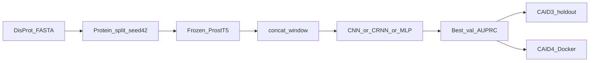
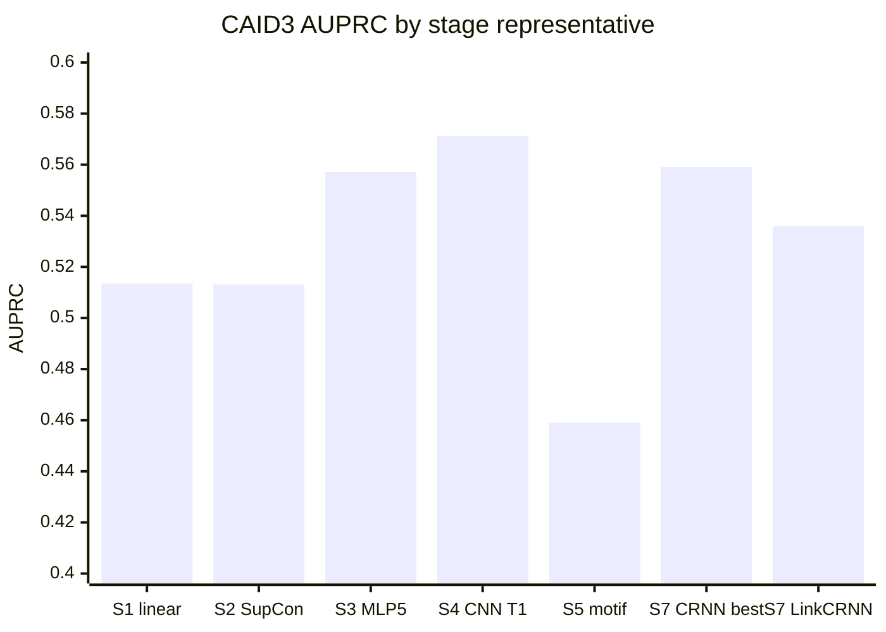

# CLIPer 项目概述与现存实验结果

指标来源：`artifacts/runs/*/exp*/metrics/{best_val_metrics,caid3_metrics}.json`。  
CAID3 holdout：**31 条蛋白 / 20,498 个计分残基**。Checkpoint 按 **验证 AUPRC** 选取；F1/MCC 阈值在 val 上网格搜索后用于 CAID 二值标签。

选模主指标是 **CAID3 AUPRC**（不平衡任务）。AUROC 普遍 0.90+，区分力弱。CRNN 上 val AUPRC 与 CAID3 经常反相关，不能单靠 val 排名定稿。

---

## 摘要

| 结论 | 数值 / 位置 |
| --- | --- |
| **全库最佳 CAID3 AUPRC / F1** | Stage 4 CNN T1 `exp0001`：**0.5713 / 0.5722**（LinkCNN） |
| **最佳 CAID3 AUROC** | Stage 4 CNN T1 regularized `exp0001`：**0.9261** |
| **提交第二方法 LinkCRNN** | Stage 7 a1 `exp0005`：AUPRC **0.5359**（四项均低于 LinkCNN） |
| **最严重 val→test 错位** | Stage 7 CRNN T1 `exp0001`：val **0.5166** → CAID **0.4619** |
| 库存 | 32 实验族 · ~68 exp 目录 · **62** 份完整 CAID3 指标 |
| CPU 推理（DP04198, 3010 aa） | Stage 4 **167 ms** · Stage 7 **406 ms**（远低于 6 h/序列） |

---

## 1. 项目是什么

**CLIPer** = Contrastive Learning for Intrinsically disordered Protein linker classification。

- **任务：** IDP linker 残基二分类（`0` 非 linker / `1` linker）
- **赛道：** CAID4 flavor `linker`；内部 holdout 为 CAID3 [`dataset/linker.fasta`](../dataset/linker.fasta)
- **主干：** 冻结 Rostlab/ProstT5，残基嵌入 `[L, 1024]`
- **训练数据：** 清洗后 DisProt 2023-12 linker [`dataset/disprot_202312_linker_label.fasta`](../dataset/disprot_202312_linker_label.fasta)，蛋白级 80/20、seed 42 → **224 train / 56 val**；排除 [`dataset/error.txt`](../dataset/error.txt)
- **清洗效果：** 去掉全 0 标签蛋白后，阳性残基占比约 0.76% → **~6.1%**（`pos_weight ≈ 14.39`）
- **训练：** 加权 BCE；长序列 1024 窗口；CLI：`python -m cliper.cli {prepare_data,train,eval,predict,extract_embeddings,runall}`
- **并列包** [`disorder/`](../disorder/)：IDR 二分类，不是 linker 主线

名称里的对比学习只在 **Stage 2**；后续阶段强制关掉 SupCon。CAID `predict` 读预计算 embedding，不跑 ProstT5（`runall` / 完整镜像才做 extract）。

实现：[`cliper/modeling.py`](../cliper/modeling.py)、[`cliper/pipeline.py`](../cliper/pipeline.py)、[`cliper/windowing.py`](../cliper/windowing.py)。配置：[`configs/`](../configs/)。

### 阶段设计

| Stage | 目标 | 分类头 | 状态 |
| --- | --- | --- | --- |
| 1 | BCE 基线 | linear | 完成 · CAID AUPRC 0.513 |
| 2 | BCE + SupCon | linear + proj | 完成 · **相对 S1 无增益** |
| 3 | 加深头，关对比 | MLP3/5/12 / Transformer | 完成 · MLP5 0.557 |
| 4 | `concat_window` | CNN / MLP / Transformer | 完成 · **CNN T1 全库最优** |
| 5 | PROSITE special token | CNN | 完成 · 全面退步；CAID 标准流不可用 |
| 6 | 双 tokenizer 融合 | dual branch | **仅配置，从未训练** |
| 7 | 连续段建模 | CRNN（CNN + biGRU） | 完成 Group A；**B–H 未跑** |

### CAID4 实际锁定（以打包文档为准）

[`submission/caid/PACKAGING.md`](../submission/caid/PACKAGING.md)：

- **CLIPer-LinkCNN：** `stage4_prostt5_cnn_concat_window_t1/exp0001`
- **CLIPer-LinkCRNN：** `stage7_prostt5_crnn_expl_a1_drop040/exp0005`

文档不一致：根 [`README.md`](../README.md) 写锁 Stage 4 T1 **regularized**；[`submission/caid/SUBMISSION.md`](../submission/caid/SUBMISSION.md) 写 Stage 7 **a3**。提交镜像以 PACKAGING 为准。

---

## 2. 实验库存

- Linker：`artifacts/runs/` 下 **32 个实验族、约 68 个 exp 目录、62 份完整 CAID3 指标**
- **失败/中断：** Stage 3 transformer `exp0001`；Stage 4 CNN regularized `exp0002`；Stage 5 若干启动失败；Stage 7 a3 `exp0001`/`exp0003`（约 epoch 5 被杀）
- **未跑：** Stage 6；Stage 7 纯 RNN；Stage 7 探索 **B–H**（容量、LSTM、半径/核、窗口、lr、细阈值、额外 seed，配置已在 [`configs/stage7_expl/`](../configs/stage7_expl/)）
- Disorder：仅 `disorder_stage3_mlp5/exp0002` 完成
- CAID smoke/profile：只有耗时，没有新 AUC

早期 Stage 1/2 用过泄漏的 2302/576 全量划分（val AUPRC ~0.06），**不可与清洗后 224/56 对照**。不少 `exp000N` 是同 seed 重复，指标完全相同。

---

## 3. 阶段演进（CAID3 AUPRC）

代表 run（清洗划分）。S4 CNN T1 = LinkCNN；S7 LinkCRNN = a1 `exp0005`（提交用，**不是** Stage 7 内部最优）。

| 代表 | 路径 | CAID3 AUPRC | AUROC | F1 | MCC | Val AUPRC | thr |
| --- | --- | ---: | ---: | ---: | ---: | ---: | ---: |
| S1 linear | `stage1_prostt5/exp0005` | 0.5135 | 0.9167* | 0.5388 | 0.5086 | 0.3642 | 0.75 |
| S2 SupCon | `stage2_prostt5_supcon/exp0008` | 0.5132 | 0.9167* | 0.5378 | 0.5074 | 0.3641 | 0.75 |
| S3 MLP5 | `stage3_prostt5_mlp5/exp0004` | 0.5572 | — | 0.5523 | 0.5205 | 0.3914 | 0.80 |
| S3 MLP12 | `stage3_prostt5_mlp12/exp0001` | 0.4225 | 0.8701* | 0.4143 | 0.4241 | 0.2489 | 0.80 |
| S3 Transformer | `stage3_prostt5_transformer/exp0002` | 0.4870 | — | 0.5170 | 0.4816 | 0.3415 | 0.80 |
| **S4 CNN T1 (LinkCNN)** | `stage4_..._cnn_concat_window_t1/exp0001` | **0.5713** | 0.9254 | **0.5722** | 0.5423 | 0.4048 | 0.75 |
| S4 CNN T1 reg | `..._t1_regularized/exp0001` | 0.5695 | **0.9261** | 0.5681 | 0.5436 | 0.3987 | 0.75 |
| S4 MLP5 r1 | `..._mlp5_concat_window_r1/exp0001` | 0.5477 | 0.9181 | 0.5405 | 0.5155 | 0.3781 | 0.80 |
| S4 TF stable | `..._transformer_concat_window_stable/exp0001` | 0.4882 | 0.8921 | 0.5208 | 0.5007 | 0.3512 | 0.75 |
| S5 motif align | `stage5_prostt5_motif/exp0005-align-stage4` | 0.4591 | 0.8975 | 0.4567 | 0.4213 | 0.3628 | 0.90 |
| S7 CRNN T1 overfit | `stage7_..._crnn_concat_window_t1/exp0001` | 0.4619 | 0.9003 | 0.5180 | 0.4899 | **0.5166** | 0.90 |
| S7 CRNN T1 seed123 | 同上 `exp0004` | 0.5591 | 0.9252 | 0.5461 | 0.5150 | 0.3910 | 0.85 |
| **S7 a1 LinkCRNN** | `..._expl_a1_drop040/exp0005` | 0.5359 | 0.9141 | 0.5386 | 0.5042 | 0.4547 | 0.85 |
| S7 a3 更强完成 run | `..._expl_a3_drop035_wd003/exp0002` | 0.5560 | 0.9245 | 0.5625 | 0.5309 | 0.4182 | 0.75 |

\* 早期 `caid3_metrics.json` 常缺 AUROC；0.9167 / 0.8701 来自后期 `auc_recalc` 或 README。

### 提交模型卡片

**CLIPer-LinkCNN** — `stage4_prostt5_cnn_concat_window_t1/exp0001`

- AUPRC **0.5713** · AUROC 0.9254 · F1 0.5722 · MCC 0.5423 · thr 0.75
- concat radius=1 → 3072-d；Conv 256×3，dilation 1/2/4；head dropout 0.25

**CLIPer-LinkCRNN** — `stage7_prostt5_crnn_expl_a1_drop040/exp0005`（seed 123）

- AUPRC **0.5359** · AUROC 0.9141 · F1 0.5386 · MCC 0.5042 · thr 0.85
- 四项全面低于 LinkCNN；提供 CNN vs CRNN 结构多样性，**不是内部 SOTA**

---

## 4. Val AUPRC vs CAID3 AUPRC

同一 checkpoint：验证集是选模指标，CAID3 是 holdout。S7 T1 overfit 验证最高（0.517）但测试仅 0.462。

| Run | Val AUPRC | CAID3 AUPRC | 差距 (CAID − val) |
| --- | ---: | ---: | ---: |
| S4 CNN T1 | 0.4048 | **0.5713** | +0.166 |
| S4 CNN reg | 0.3987 | 0.5695 | +0.171 |
| S3 MLP5 | 0.3914 | 0.5572 | +0.166 |
| S7 a3 | 0.4182 | 0.5560 | +0.138 |
| S7 a1 LinkCRNN | 0.4547 | 0.5359 | +0.081 |
| S7 a2 wd=0.05 | **0.5022** | 0.5208 | +0.019 |
| **S7 T1 overfit** | **0.5166** | **0.4619** | **−0.055** |
| S5 motif | 0.3628 | 0.4591 | +0.096 |
| S1 linear | 0.3642 | 0.5135 | +0.149 |

**不要用最高 val AUPRC 直接提交。** Stage 7 CRNN T1 `exp0001`：val 0.5166（全库最高）→ CAID 0.4619。正则化（a1 drop 0.40 / a3 drop 0.35 + wd 0.03）把 CAID 拉回 0.536–0.556，仍低于 CNN T1。

同配置内部也有错位：Stage 4 CNN T1 `exp0003` val 最好（0.420）但 CAID 只有 0.528。

---

## 5. 各实验族最优（按 CAID3 AUPRC）

每族取 CAID3 AUPRC 最高的一次完成 run。同 seed 重复已折叠。

| Family | Exp | CAID AUPRC | AUROC | F1 | MCC | Val AUPRC |
| --- | --- | ---: | ---: | ---: | ---: | ---: |
| stage4_cnn_t1 | exp0001 | **0.5713** | 0.9254 | **0.5722** | 0.5423 | 0.4048 |
| stage4_cnn_t1_regularized | exp0001 | 0.5695 | **0.9261** | 0.5681 | 0.5436 | 0.3987 |
| stage7_crnn_t1 | exp0004 | 0.5591 | 0.9252 | 0.5461 | 0.5150 | 0.3910 |
| stage3_mlp5 | exp0004 | 0.5572 | — | 0.5523 | 0.5205 | 0.3914 |
| stage7_a1_drop040 | exp0001–0003 | 0.5561 | 0.9236 | 0.5498 | 0.5167 | 0.4070 |
| stage7_a3_drop035_wd003 | exp0002/0004 | 0.5560 | 0.9245 | 0.5625 | 0.5309 | 0.4182 |
| stage4_mlp3_concat_window | exp0001 | 0.5536 | 0.9097 | 0.5366 | 0.5026 | 0.3768 |
| stage4_cnn (r=2) | exp0001 | 0.5502 | 0.9234 | 0.5690 | 0.5446 | 0.3946 |
| stage4_cnn_t2 | exp0001 | 0.5498 | 0.9164 | 0.5663 | 0.5354 | 0.3952 |
| stage4_mlp5_r1 | exp0001 | 0.5477 | 0.9181 | 0.5405 | 0.5155 | 0.3781 |
| stage7_a4_topdrop02 | exp0001 | 0.5462 | 0.9220 | 0.5596 | 0.5288 | 0.4005 |
| stage7_a6_patience4 | exp0001 | 0.5431 | 0.9058 | 0.5343 | 0.5014 | 0.3683 |
| stage4_cnn_t3_balanced | exp0001 | 0.5408 | 0.9217 | 0.5512 | 0.5196 | 0.4010 |
| stage3_mlp5_dropout_decay | exp0002 | 0.5385 | 0.9135 | 0.5142 | 0.4831 | 0.3580 |
| stage4_transformer_t3 | exp0001 | 0.5366 | 0.9069 | 0.4628 | 0.4485 | 0.2973 |
| stage7_a1 **LinkCRNN 提交** | exp0005 | 0.5359 | 0.9141 | 0.5386 | 0.5042 | 0.4547 |
| stage3_mlp3_dropout_decay | exp0001 | 0.5250 | 0.9058 | 0.5161 | 0.4840 | 0.3645 |
| stage7_a2_wd005 | exp0001 | 0.5208 | 0.9066 | 0.5192 | 0.4923 | 0.5022 |
| stage4_mlp5_r3 | exp0001 | 0.5195 | 0.9210 | 0.5713 | 0.5402 | 0.4025 |
| stage1_linear（清洗划分） | exp0005 | 0.5135 | — | 0.5388 | 0.5086 | 0.3642 |
| stage2_supcon（清洗划分） | exp0008 | 0.5132 | — | 0.5378 | 0.5074 | 0.3641 |
| stage4_transformer_t1 | exp0001 | 0.5055 | 0.9017 | 0.5053 | 0.4823 | 0.3492 |
| stage4_mlp5_r2 / base | exp0001 | 0.5013 | 0.9169 | 0.5424 | 0.5161 | 0.3810 |
| stage4_transformer_stable | exp0001 | 0.4882 | 0.8921 | 0.5208 | 0.5007 | 0.3512 |
| stage3_transformer | exp0002 | 0.4870 | — | 0.5170 | 0.4816 | 0.3415 |
| stage7_a5_rnn1layer | exp0001 | 0.4736 | 0.9125 | 0.5266 | 0.5006 | 0.3719 |
| stage7_crnn_t1 **overfit** | exp0001 | 0.4619 | 0.9003 | 0.5180 | 0.4899 | 0.5166 |
| stage5_motif_align | exp0005-align-stage4 | 0.4591 | 0.8975 | 0.4567 | 0.4213 | 0.3628 |
| stage5_motif_lite_head | exp0001 | 0.4546 | 0.8929 | 0.4594 | 0.4233 | 0.3341 |
| stage5_motif_emb64 | exp0003 | 0.4295 | 0.8874 | 0.4491 | 0.4078 | 0.3309 |
| stage4_transformer_t2 | exp0001 | 0.4286 | 0.8990 | 0.5220 | 0.5040 | 0.3255 |
| stage3_mlp12 | exp0001 | 0.4225 | 0.8701* | 0.4143 | 0.4241 | 0.2489 |
| stage4_transformer **坍缩** | exp0001 | 0.1408 | 0.7205 | 0.1261 | 0.0000 | 0.0813 |

### 分阶段要点

- **S1→S3 MLP5：** +0.044 AUPRC，第一次明显跃升。MLP12 掉到 0.423（过参数化）；Transformer 0.487；dropout decay 退到 ~0.52。
- **S3→S4 CNN T1：** 再 +0.014。局部膨胀卷积 + `concat_window`（r=1）是主要归纳偏置。r=2 / t2 r=3 / t3：0.541–0.550，不及 T1。MLP concat r1 0.548；r3 F1 高（0.571）但 AUPRC 仅 0.520。Transformer concat 不稳定，一次坍缩到 0.141。
- **S2 SupCon：** 与 S1 几乎相同（0.513），对比学习没有带来收益。
- **S5 PROSITE：** 最好的 align-stage4 也只有 0.459。Motif 覆盖约 16–18%。不适合标准 CAID（预计算 embedding 无法做 special-token 编码）。
- **S7 CRNN：** T1 seed 123（`exp0004`）CAID 0.559，最接近 CNN。a3 `exp0002` 达 0.556 / F1 0.562，**优于提交用的 a1 `exp0005`（0.536）**。a5 单层 GRU：0.474，容量过小。
- **Disorder**（另一任务）：`disorder_stage3_mlp5/exp0002` 测试 AUPRC 0.667。用 linker MLP5 去预测 disorder 只有 0.440 —— linker 头不能当 IDR 模型用。
- **`Statistics.xlsx`** 中 Stage3-MLP12 AUPRC 与 JSON（0.423）不一致，**以 JSON 为准**。

---

## 6. 机制解读

1. **局部卷积 + 邻域拼接有效：** linker 是短连续片段，膨胀 CNN（dilation 1/2/4）比线性 / 过深 MLP / 小 Transformer 更合适。
2. **SupCon 无效：** 冻结 ProstT5 后残基空间可能已经可分；Stage 2 投影头没有改变 CAID 排序。
3. **Motif token 有害：** 改 tokenizer 破坏了与预计算 embedding 的一致性，且 motif 覆盖低。
4. **RNN 过拟合 val：** CRNN 能记住 DisProt val 上的连续段模式（56 条蛋白），CAID3 的 31 条分布不同。应以 CAID3（或重复 seed）而不是单一 val AUPRC 选模型。
5. **CAID3 n=31 噪声大：** 0.571 vs 0.569 vs 0.557 的差距可能小于分割/seed 方差；README 自己也写了缺 multi-seed 均值。
6. **提交折中：** 第二方法 LinkCRNN 在内部测试上更弱，但提供结构多样性（CNN vs CRNN），符合多方法提交，而不是内部 SOTA。

---

## 7. 文档矛盾、缺口与选模建议

| 文档 | 锁定模型 | 与 PACKAGING 是否一致 |
| --- | --- | --- |
| `PACKAGING.md` + 镜像 README | LinkCNN = S4 T1 `exp0001`；LinkCRNN = S7 a1 `exp0005` | 基准 |
| `README.md`（2026-05） | S4 T1 **regularized** `exp0001` | 接近但不相同（reg 0.5695 vs T1 0.5713） |
| `SUBMISSION.md` | S7 **a3** drop035_wd003 | 否 — 内部更强但未按此打包 |

README 对照表停在 2026-04-28，**未写入 Stage 7，也未写入实际更优的 CNN T1 `exp0001`（0.571）**。

### 未跑 / 未完成

- Stage 6 双 tokenizer：配置存在，零 artifact
- Stage 7 纯 RNN；探索 B–H（容量 / LSTM / 半径 / 窗口 / lr / seed）
- Stage 3 完整 lr/dropout 网格（计划写了但未全做）
- 失败：S3 TF `exp0001`、S4 reg `exp0002`、S5 启动失败、S7 a3 `exp0001`/`exp0003`

### 可信选模建议

1. **主方法继续用 LinkCNN**（S4 T1 `exp0001`）。若只交一个模型，优先它。
2. 第二方法若追求 CAID3 分数，可考虑 **a3 `exp0002`（0.556）** 或 **T1 seed123（0.559）**，而非当前 a1 `exp0005`（0.536）。
3. 若同步文档：README 对照表应补上 Stage 7 与 T1 0.5713；统一三处「锁定 checkpoint」表述。
4. 报告时注明单 run；理想补 multi-seed mean±std。

---

## 8. T2 / T3（LinkCNN vs LinkCRNN，内部协议评测）

在 **不改权重** 的前提下，按 Basu 风格协议对两个提交模型补做 T2 / T3。脚本：`scripts/build_t3_negatives_fasta.py`、`scripts/eval_protocol_t2_t3.py`。

| 模型 | checkpoint | 阈值（仅 F1/MCC） | 产物目录 |
| --- | --- | ---: | --- |
| **LinkCNN** | `stage4_prostt5_cnn_concat_window_t1/exp0001` | 0.75 | `artifacts/protocol_eval/linkcnn_t1_exp0001/` |
| **LinkCRNN** | `stage7_prostt5_crnn_expl_a1_drop040/exp0005` | 0.85 | `artifacts/protocol_eval/linkcrnn_a1_exp0005/` |

推理：冻结 ProstT5 + classifier-only 头；val / T3 负集用 `disorder/prostt5_features`；CAID3 用 `tmp/caid3_test_linkcnn/emb`（CNN 另复用已有 `.caid`）。

### T2：IDR 内 DL vs 其它无序残基

仅评测 `disorder==1` 且 linker∈{0,1} 的残基。val：56 蛋白、2587 pos / 3706 neg；CAID3：31 蛋白、1379 / 1002。

| 切片 | 模型 | AUPRC | AUROC | F1 | MCC |
| --- | --- | ---: | ---: | ---: | ---: |
| 内部 val | LinkCNN | 0.738 | 0.794 | 0.641 | 0.437 |
| 内部 val | **LinkCRNN** | **0.791** | **0.824** | **0.681** | **0.515** |
| CAID3 | **LinkCNN** | **0.859** | **0.837** | **0.729** | **0.472** |
| CAID3 | LinkCRNN | 0.850 | 0.819 | 0.691 | 0.457 |

CRNN 在 **val T2 更强**（与 T1 上 val 偏高、CAID 偏低的模式一致）；CAID3 T2 仍是 CNN 略好。相对各自 T1 CAID3 AUPRC（CNN 0.571 / CRNN 0.536），限制在 IDR 内后排序都明显更好——AUPRC 会被本切片较高阳性率抬高，不宜直接对标 Basu 扩评。

### T3：蛋白是否 harboring DL

- 正：`val_ids` **56**；负：从 not_cleaned 全 0 linker 池抽样 **168**（seed=42，1:3）→ `artifacts/splits/disprot_t3_negatives_seed42.{json,fasta}`
- 主聚合：`max_window31_mean`（窗长 31 滑动均值再取 max）；另报 `max`、`top10_mean`
- **非 CAID3 官方 T3**（CAID3 linker 集无负蛋白）

| 聚合 | LinkCNN AUPRC / AUROC | LinkCRNN AUPRC / AUROC |
| --- | ---: | ---: |
| **max_window31_mean（主）** | 0.366 / 0.638 | **0.389 / 0.653** |
| max | **0.456 / 0.677** | 0.420 / 0.676 |
| top10_mean | **0.440 / 0.676** | 0.414 / 0.678 |

蛋白级仍然弱（随机 AUPRC≈0.25）。主聚合上 CRNN 略高于 CNN；`max` / `top10_mean` 上 CNN 更好。两边都远未到可用的蛋白质组筛选水平。JSON：各目录下 `t2_val.json`、`t2_caid3_pdb.json`、`t3_internal.json`。

### Stage7 三分类 + IDR SupCon（适应 T2；内部协议）

从头训 CRNN a1（`stage7_prostt5_crnn_expl_a1_t2_ternary/exp0002`）：残基三类 CE（Linker / 其它 IDR / 有序）+ 仅在 {0,1} 上 SupCon；分数 = softmax P(Linker)；选模 = **val T2 AUPRC**（best epoch 21，early-stop 27，thr=0.5）。**非** Basu 348 公开榜；未做 T3、未改 CAID Docker。产物：`artifacts/protocol_eval/linkcrnn_a1_t2_ternary/`。

四项指标均为 **AUPRC / AUROC / F1 / MCC**（F1/MCC 用各自阈值）。

**T1**（全残基；二分类 a1 对照取 CAID3 提交卡 / Val AUPRC 见上表 0.4547）：

| 切片 | 模型 | AUPRC | AUROC | F1 | MCC |
| --- | --- | ---: | ---: | ---: | ---: |
| 内部 val | 三分类 a1 | 0.458 | 0.898 | 0.500 | 0.471 |
| CAID3 | 三分类 a1 | 0.455 | 0.867 | 0.491 | 0.454 |
| CAID3 | 二分类 a1 | **0.536** | **0.914** | **0.539** | **0.504** |

**T2**（IDR 内；与 §8 上表同切片：val 2587/3706，CAID3 1379/1002）：

| 切片 | 模型 | AUPRC | AUROC | F1 | MCC |
| --- | --- | ---: | ---: | ---: | ---: |
| 内部 val | 三分类 a1 | **0.838** | **0.855** | **0.707** | **0.587** |
| 内部 val | 二分类 a1 | 0.791 | 0.824 | 0.681 | 0.515 |
| CAID3 | 三分类 a1 | 0.850 | 0.821 | 0.637 | 0.443 |
| CAID3 | 二分类 a1 | 0.850 | 0.819 | **0.691** | **0.457** |

相对二分类 a1：**val T2 四项均升**；CAID3 T2 的 AUPRC/AUROC 持平、F1/MCC 略降；**T1 CAID3 四项均降**——三分类目标偏向 IDR 内区分，对全序列 T1 不利。
