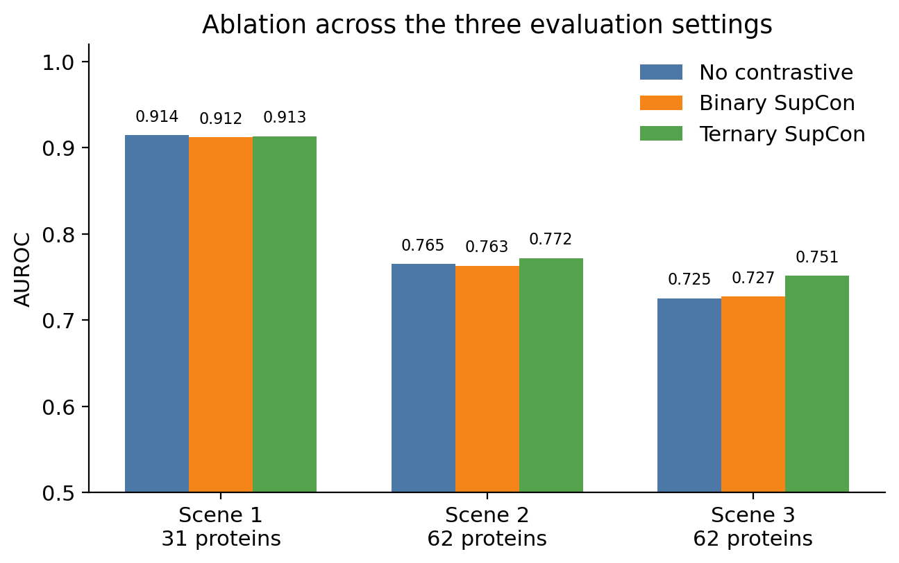
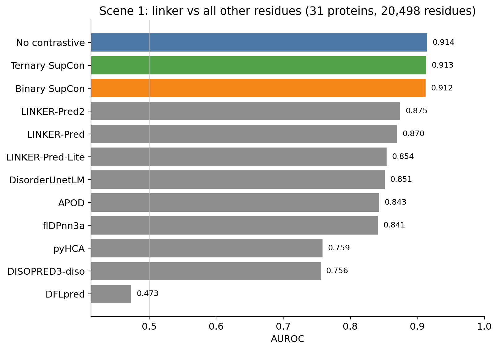
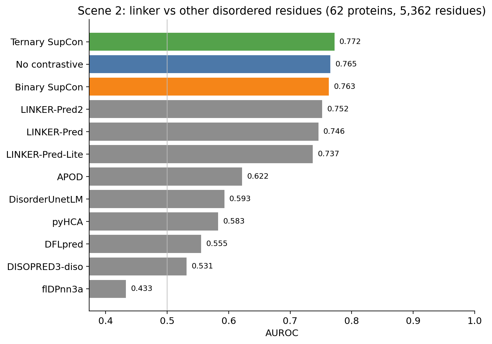
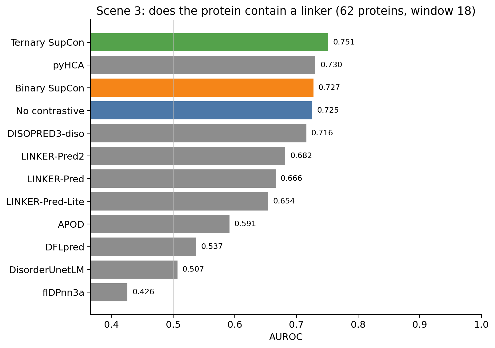
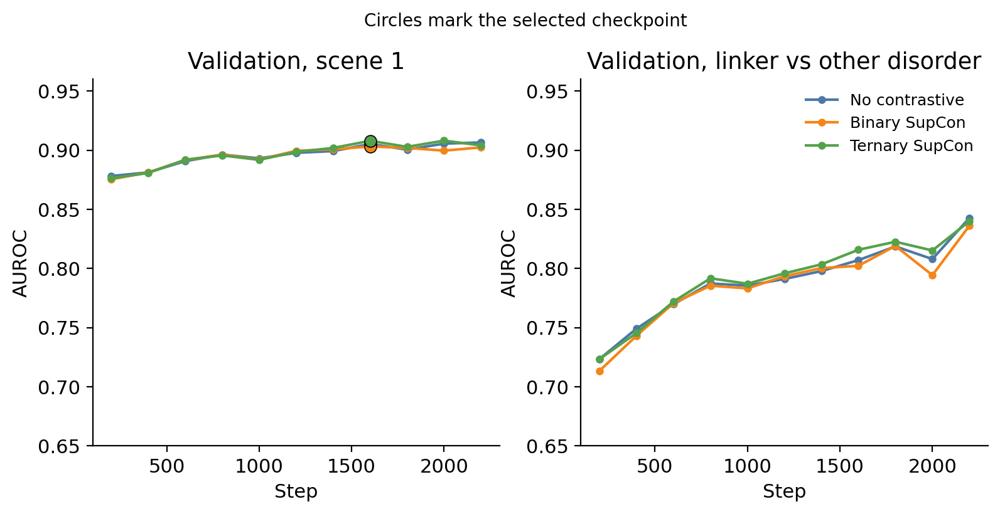
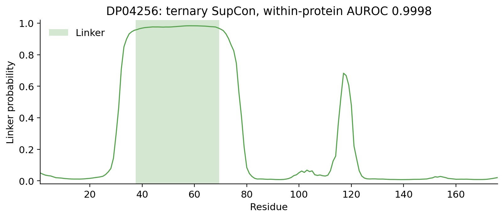

# 实验结果总结

日期：2026-10-24。数字来自本机已下载的三组消融结果，以及 `dataset/caid3/predictions.zip` 里其他方法的连续分数（`.caid` 第 3 列）。对比图只收录在该场景每一个被评分残基上都有分数的方法。图由 `paper/figures/plot_results.py` 生成，对应数字写在 `paper/figures/figure_numbers.json`。

## 模型和数据

主干是冻结的 ProstT5。每个残基取半径 1 的嵌入并拼接，送入一个小 CRNN：一层卷积（128 通道，核宽 3）加一层双向 GRU（隐藏维 64）。输出是 linker 概率。训练目标是 linker 对其余残基的加权二元交叉熵。三组实验只改对比学习项：

- 无对比学习
- 二元 SupCon：linker 对其余残基，权重 0.2
- 三元 SupCon：有序、其他无序、linker 三类，权重 0.2

训练集和验证集是 `t2_seqneg`（seed 42）：224 条含 linker 的蛋白质加 224 条只有无序、不含 linker 的蛋白质进入训练，验证集各 56 条。CAID3 的 31 条 linker 蛋白质不在训练和验证中。

三个场景：

| 场景 | 问题 | 样本 |
| --- | --- | --- |
| 场景 1 | 残基是不是 linker | 31 条 CAID3 linker 蛋白质，20,498 个残基（1,379 个 linker，19,119 个非 linker） |
| 场景 2 | 在无序残基里，是 linker 还是其他无序 | 上述 31 条，再加上 31 条 disorder-PDB 中不含 linker 的蛋白质。评分残基 5,362 个（1,379 个 linker，3,983 个其他无序） |
| 场景 3 | 这条蛋白质里有没有 linker | 同样 62 条蛋白质。分数是长度 18 的窗口内 linker 概率的最大平均值。18 是 31 条阳性蛋白质上 linker 连续段长度的中位数 |

三组都在第 10 个 epoch、step 2200 早停。选择标准是验证集场景 1 的 AUROC，最小提升 0.002，耐心 3。保存的是验证集场景 1 最好的检查点，阈值 0.95。

## 消融

| 模型 | 场景 1 AUROC | 场景 1 AUPRC | 场景 2 AUROC | 场景 2 AUPRC | 场景 3 AUROC | 场景 1 F1 | 场景 1 MCC |
| --- | ---: | ---: | ---: | ---: | ---: | ---: | ---: |
| 无对比学习 | 0.914 | 0.525 | 0.765 | 0.583 | 0.725 | 0.458 | 0.444 |
| 二元 SupCon | 0.912 | 0.523 | 0.763 | 0.586 | 0.727 | 0.470 | 0.454 |
| 三元 SupCon | 0.913 | 0.526 | **0.772** | **0.595** | **0.751** | **0.489** | **0.473** |

场景 1 上三组几乎一样，都在 0.912–0.914。对比学习的差别出现在更难的设置里：三元 SupCon 把场景 2 从 0.765 提到 0.772，把场景 3 从 0.725 提到 0.751。二元 SupCon 在场景 2 上没有超过不加对比学习的模型。

加入 31 条无序非 linker 蛋白质之后，场景 2 比只在原来 31 条上做“linker 对其他无序”下降了大约 0.05：

| 模型 | 仅 31 条、2,381 个残基 | 62 条、5,362 个残基 |
| --- | ---: | ---: |
| 无对比学习 | 0.813 | 0.765 |
| 二元 SupCon | 0.813 | 0.763 |
| 三元 SupCon | 0.825 | 0.772 |

## 和已有方法的对比

灰色柱是其他方法，彩色柱是本次三个模型。AUROC 用同一批残基、同一套标签重算，没有使用官方表格里按阈值二值化之后的结果。

### 场景 1

在全部 20,498 个残基上都有分数的方法里，三个模型（0.912–0.914）高于 LINKER-Pred2（0.875）、LINKER-Pred（0.870）、LINKER-Pred-Lite（0.854）、DisorderUnetLM（0.851）、APOD（0.843）和 flDPnn3a（0.841）。这些 LINKER-Pred2、LINKER-Pred、LINKER-Pred-Lite、DisorderUnetLM、APOD、flDPnn3a 的数字与 CAID3 linker 赛道公布的名次表一致。

下面这些方法没有覆盖全部残基，所以没有放进图里。括号里是实际覆盖的蛋白质数、残基数和阳性残基数：

| 方法 | AUROC | 覆盖 |
| --- | ---: | --- |
| IPA-AF2-Linker | 0.897 | 28 条，15,809 残基，1,214 阳性 |
| DisoFLAG-IDR | 0.856 | 30 条，17,488 残基，1,339 阳性 |
| DisoFLAG-DFL | 0.846 | 30 条，17,488 残基，1,339 阳性 |
| ESMDisPred-2PDB | 0.836 | 25 条，11,024 残基，1,189 阳性 |
| EBIND-nucleic-acid | 0.833 | 24 条，10,069 残基，1,175 阳性 |

IPA-AF2-Linker 的 0.897 与官方表一致，但它少了 3 条蛋白质，不能和 0.914 直接比高低。

### 场景 2

在完整的 5,362 个无序残基上，三元 SupCon（0.772）高于 LINKER-Pred2（0.752）、LINKER-Pred（0.746）和 LINKER-Pred-Lite（0.737）。无序预测方法在这个场景里明显下降：APOD 0.622，DisorderUnetLM 0.593，flDPnn3a 0.433。flDPnn3a 在场景 1 有 0.841，到了“两种残基都无序”之后降到随机以下，说明它主要在区分无序和有序。

覆盖不全、未进入图中的方法：

| 方法 | AUROC | 覆盖 |
| --- | ---: | --- |
| EBIND-nucleic-acid | 0.771 | 51 条，3,833 残基，1,175 阳性 |
| IPA-AF2-Linker | 0.741 | 56 条，4,637 残基，1,214 阳性 |
| DisoFLAG-DFL | 0.734 | 60 条，4,888 残基，1,339 阳性 |
| ESMDisPred-2PDB | 0.542 | 52 条，3,847 残基，1,189 阳性 |
| DisoFLAG-IDR | 0.508 | 60 条，4,888 残基，1,339 阳性 |

EBIND 的 0.771 接近三元 SupCon 的 0.772，但少了 11 条蛋白质和约 1,500 个残基，不能算同一测试集上的比较。

### 场景 3

窗口固定为 18，62 条蛋白质都有分数时，三元 SupCon 最高，AUROC 0.751。下一名是 pyHCA，0.730。无对比学习和二元 SupCon 分别是 0.725 和 0.727，略低于 pyHCA。LINKER-Pred2 是 0.682。flDPnn3a 降到 0.426。

覆盖不全的方法：EBIND-nucleic-acid 0.764（51 条，24 个阳性），DisoFLAG-DFL 0.656（60 条，30 个阳性），ESMDisPred-2PDB 0.616（52 条，25 个阳性），IPA-AF2-Linker 0.558（56 条，27 个阳性），DisoFLAG-IDR 0.510（60 条，30 个阳性）。IPA 在场景 1 很强，到了“这条无序蛋白质里有没有 linker”就接近随机。62 条的样本很小，0.751 和 0.730 只说明在这套蛋白质上的排序。

## 训练曲线

左图是验证集场景 1，右图是验证集上“linker 对其他无序”。圆点是被保存的检查点。场景 1 在 step 1600 之后基本不再上升，早停因此停在这里。右图在 step 2200 仍在上升，所以保存下来的检查点不是场景 2 验证分数最高的那个点。三组在训练后期的场景 1 训练 AUROC 约为 0.944–0.945，验证 AUROC 约为 0.903–0.908，差距大约 0.04。

## 一条序列

DP04256 长 176，有一段 32 个残基的 linker，没有其他无序区。三元 SupCon 在这段上的概率接近 1，段外很快回到 0 附近。这条蛋白质内部的 AUROC 是 0.9998。第 115 位附近有一个约 0.7 的峰，落在有序残基上，是这段序列里的假阳性。

这是长度 150–700、linker 残基不少于 15 的阳性蛋白质里，单条 AUROC 最高的一条，用来看模型能否把一段 linker 从两侧分开。31 条阳性蛋白质的单条 AUROC 中位数是 0.950，有 20 条不低于 0.90；最低的是 DP04166，0.569。

## 更早的一组模型

`paper/results/linkcnn` 和 `paper/results/linkcrnn` 是另一套训练：只用含 linker 的蛋白质，没有额外的无序非 linker 蛋白质，也没有场景 2 和场景 3。它们在同样的 31 条、20,498 个残基上：

| 模型 | AUROC | AUPRC | F1 | MCC |
| --- | ---: | ---: | ---: | ---: |
| LinkCNN | 0.925 | 0.571 | 0.572 | 0.542 |
| LinkCRNN | 0.914 | 0.536 | 0.539 | 0.504 |

这组数字不能和上面的消融放在同一张图里。上面的 0.912–0.914 是加了等量无序非 linker 蛋白质、并且做了对比学习消融之后的结果。

## 读日志时的两个口径

训练日志里 `[eval]` 的 scene2 AUROC 大约是 0.90。那是把 62 条全部残基按场景 1 的规则来评（linker 对有序加其他无序，35,862 个残基），不是场景 2。场景 2 要看 `three_scenes/summary.json` 里的 `scene2_auroc`，也就是上表的 0.763–0.772。

F1 和 MCC 使用阈值 0.95。三元 SupCon 在场景 1 上是 F1 0.489、MCC 0.473。
